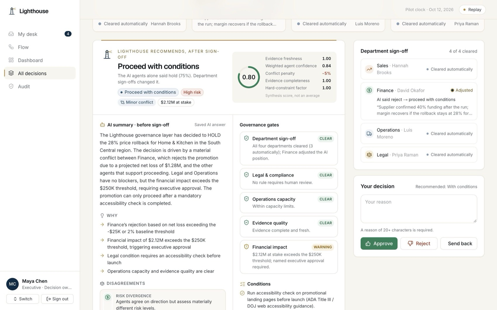

# Lighthouse

**AI Agent Orchestration & Decision Intelligence System** · ISTM 6210 / 4210 Capstone · Fall 2026 · The George Washington University

Team: Ajay · Bhavya · Ehson · Jaehoon · Kunal · Wilfred — Faculty Advisor: Dr. Soheil Sibdari

Lighthouse is a governance layer above four department AI agents (**Sales, Finance, Operations, Legal**) for Walmart U.S. promotion and inventory decisions. **Each agent is owned by a department lead.** Submitting a case runs all four automatically; each agent gathers evidence with deterministic tools and reasons over it with an LLM. A lead **signs off only when their agent raises a concern** (confirm, adjust with a reason, or block). Lighthouse **surfaces conflicts instead of averaging them away**, reconciles again on what the departments signed, and hands the final call to a **named executive**, who can overrule Sales, Finance or Operations with a written reason but never Legal. Every step is written to an **append-only, SHA-256 hash-chained audit log**.



> Academic prototype; not affiliated with Walmart Inc. Demand patterns come from public Kaggle Walmart datasets; store IDs, inventory, legal rules and costs are generated and labelled as such. Legal outputs are compliance-risk indicators, not legal advice.

## What it does

| Capability | How |
|---|---|
| Four AI agents, one output contract | Each agent returns `recommendation, confidence, risk_level, evidence_ids, conditions, dissent_reason, rationale`, validated with Zod |
| Evidence first | Agents call deterministic tools (SQL over 436K pilot rows) and must cite evidence IDs; unknown citations are removed and flagged |
| Guardrails | Hard constraints (legal prohibition, review requirement, capacity hard stop, missing data) cannot be overridden by the model |
| Conflict detection | Support-vs-oppose, legal gate, hard stop, evidence and risk-divergence conflicts, shown explicitly |
| Governed synthesis | Deliverable 1 §4.2 rules decide the recommendation; the LLM writes the executive narrative only |
| Confidence | Synthesis score = weighted agent confidence × evidence completeness × freshness × (1 − conflict penalty) |
| Department ownership | Four leads own one agent each: they re-run it, confirm it, adjust it (reason required, costs confidence) or block it |
| Management by exception | A lead signs only when their agent says hold/reject/review, is under 65% confident or lacks evidence; the rest clears automatically |
| Human in the loop | The executive approves only when every lane is resolved; Legal can never be overruled; overdue non-legal sign-offs escalate after 48h; overrides need a written reason |
| Audit | Append-only table with a database trigger; hash chain verifiable in one click |
| Free AI stack | Gemini (free tier) → Groq gpt-oss-120b / Qwen / gpt-oss-20b (free tier) → deterministic rules engine; plus demo-safe replay |
| Security | Untrusted text is quoted as data and screened for prompt injection; role-based actions; separation of duties |

## Data

| Source | Provenance | Used for |
|---|---|---|
| [M5 Forecasting (Walmart)](https://www.kaggle.com/competitions/m5-forecasting-accuracy) | Real | Daily demand shape, seasonality, events, prices (22M values, 6.8M price rows) |
| [Walmart 45-store weekly sales](https://www.kaggle.com/datasets/yasserh/walmart-dataset) | Real | Store size distribution for the 50 pilot stores |
| Walmart FY2026 Form 10-K | Public | Level calibration ($4.8B for 50 stores), eCommerce share |
| Inventory, DC capacity, legal rules, costs, cases | Generated | Everything no public dataset covers (seeded, reproducible) |

The real Oct 2014–Oct 2015 window is re-dated by exactly 4,018 days (574 weeks) so weekdays and holidays align with the Oct 2025–Oct 2026 pilot year. Result: 219,000 daily sales rows, 217,506 operations rows, 250 legal rules, 5,000 decision cases, 19,952 historical agent outputs, ~154K evidence records, ~22K audit entries.

## Stack

Next.js 16 (App Router, TypeScript) · Tailwind CSS 4 · Neon Postgres · Google Gemini & Groq (free tiers) · Recharts · Motion · Vercel

```
src/lib/engine/     deterministic agent tools, guardrails, Lighthouse reconciliation
src/lib/ai/         provider chain, agent prompting + validation, synthesis, input screening
src/lib/runs.ts     streaming run orchestrator (SSE) and persistence
src/lib/signoff.ts  department lanes, exception rules, signed reconciliation
src/lib/governance.ts executive decision rules (locks, overrides, escalation)
src/lib/testlab.ts  18 acceptance tests (Deliverable 1 §7.2, OBJ-01..07, sign-off rules)
db/schema.sql       schema, append-only audit trigger, hash chain, compute_case_facts()
scripts/data/       Kaggle → pilot dataset pipeline (Python) and loader
scripts/seed.ts     rules-engine run over 4,988 historical cases + audit ledger
```

## Run locally

```bash
cp .env.example .env.local        # add GEMINI_API_KEY, GROQ_API_KEY, DATABASE_URL (all free)
npm install
python3 -m venv .venv && .venv/bin/pip install pandas numpy "psycopg[binary]" kagglehub
.venv/bin/python -I scripts/data/build_dataset.py   # needs the Kaggle files in data/raw/
.venv/bin/python -I scripts/data/load_db.py
npx tsx scripts/seed.ts && npx tsx scripts/migrate.ts
npx tsx --conditions=react-server scripts/reset-demo.ts   # class-demo starting state
npm run dev
```

Demo personas: **Maya Chen** (executive, decides) · department leads **Hannah Brooks** (Sales, proposes promotions), **David Okafor** (Finance), **Luis Moreno** (Operations), **Priya Raman** (Legal) · **Jordan Ellis** (system administrator, PIN `4210`, override with `ADMIN_PIN`; cannot decide).

See [docs/Lighthouse_Demo_Guide.pdf](docs/Lighthouse_Demo_Guide.pdf) for the full demo script.
